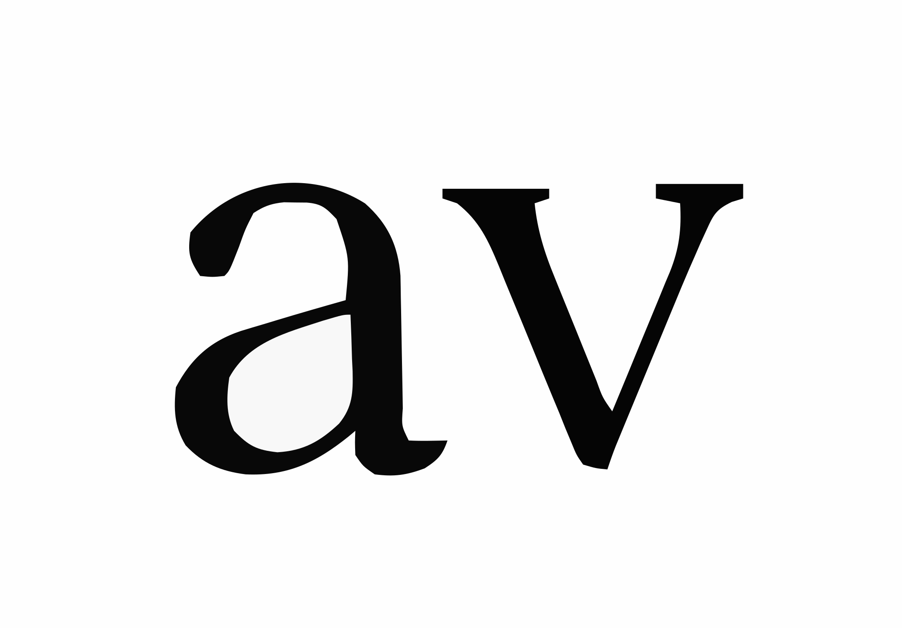

<p align="center">
  
</p>

# AU VIERRE

I created this custom storefront for AU VIERRE, a small clothing brand. It's live at **[auvierre.us](https://auvierre.us/)**.

Visitors enter through an animated logo with music, then scroll through a WebGL particle field into the collection and lookbook. Products, payments, and checkout run on Shopify.

## Background

- **Logo:** inspired by an early-2000s Dior logo.
- **Animation:** I had the logo animation made for the intro. It plays as a transparent video on top of the particle field.
- **Music:** the soundtrack was made by producer [4MULA](https://www.instagram.com/prod4mula/).

## Tech stack

| Area | Technology |
| --- | --- |
| Commerce | Shopify, Liquid, Horizon base theme |
| Graphics | Three.js (WebGL) |
| Front end | HTML, CSS, vanilla JavaScript (ES modules) |
| Cart | Shopify AJAX Cart API |
| Media | HTML5 audio and video, Web Audio API |
| Concept build | Vite, Vercel |

## Features

- **Intro:** a tap-to-enter screen starts the video and audio, which mobile browsers won't autoplay with sound.
- **Logo video:** transparent animation served as HEVC, WebM, or MP4, depending on the browser.
- **Particle field:** 700 Three.js particles, with a camera that follows the scroll and the cursor.
- **Soundtrack:** a two-track playlist with a sound toggle.
- **Shop:** product grid with image zoom, size selection, specs and sizing, and stock labels.
- **Cart:** custom slide-out cart that hands off to Shopify checkout.
- **Lookbook:** continuously scrolling image marquee.
- **Info and contact:** shipping, returns, and privacy pop-ups, plus a contact form that submits without a page reload.
- **Pre-launch page:** branded password page with an email sign-up.

## Repository structure

```text
shopify/                 Theme files for the live site
├── theme.liquid         Site layout
├── index.liquid         Home page
├── password.liquid      Password and email sign-up page
├── setup.js             Three.js scene, intro, audio, contact form
├── cart.js              Cart and checkout handoff
├── modal.js             Image zoom, specs, and policy pop-ups
├── style.css            Site styles
├── assets/              Images, textures, and font
├── music/               Soundtrack
└── favicon_io/          Favicons and web manifest

index.html, src/, three/, public/    Original Vite concept
```

## Deployment

- **Live site:** [auvierre.us](https://auvierre.us/) runs on Shopify, and theme changes are made through Shopify. Pushing to this repo doesn't update the store.
- **Concept:** the [Vercel site](https://auvierre-concept.vercel.app) builds from the root of this repo and redeploys on every push to `main`.

To run the concept locally:

```bash
npm install
npm run dev
```

The `shopify/` files need a Shopify store to render, so they won't run through Vite.

## Credits

- **Development:** [AAMUNE](https://www.instagram.com/aamune/)
- **Music:** [4MULA](https://www.instagram.com/prod4mula/)

© 2026 AU VIERRE. All rights reserved.
